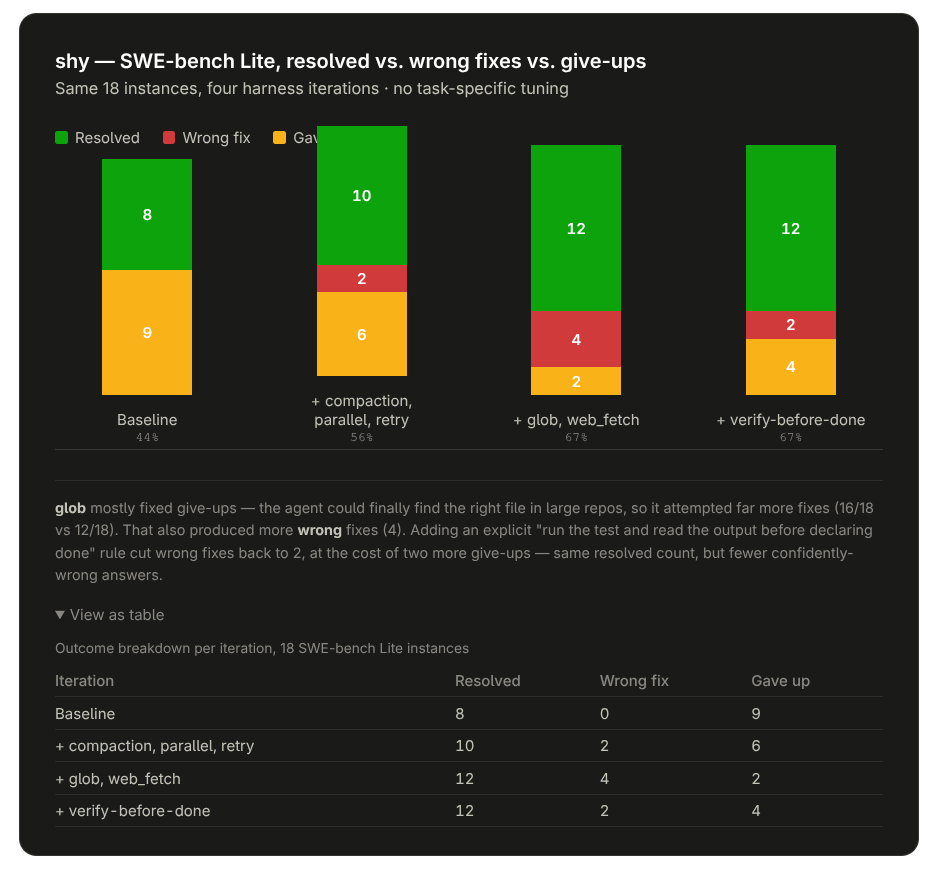

# shy

A small TypeScript coding-agent harness built to benchmark how much a cheaper,
smaller model can improve through orchestration: tool selection, context
management, retries, and verification. The goal is experimental measurement,
not a production multi-tenant service.

Runs on [Bun](https://bun.com), talks to any OpenAI-compatible chat completions
API (currently wired to DeepSeek).

## Benchmark results (historical; revalidate before comparing)

The tables below record results from earlier experiments. They are historical
claims, not proof that every feature described below exists in the current
implementation. Re-run the benchmark artifacts against the exact commit and
record the commit, model identifier, task set, and configuration before using
these numbers as a current baseline.

**Previously reported private eval suite:**

| Iteration | Passed | Avg Quality (Jev) | Avg Tokens | Avg Time |
|---|---|---|---|---|
| Before Jev | 11/11 | — | ~60k/task | ~38s/task |
| After Jev | 11/11 | 3.41/4 | ~7.6k/task | ~7.6s/task |

These figures describe a previously reported experiment. Do not attribute the
token or latency changes to the current loop until the Jev integration and
evaluation path are verified at the commit being benchmarked.

**SWE-bench Lite** (same 18 real GitHub issues, official Docker-based evaluation,
re-run after each round of harness changes — no task-specific tuning):

| Iteration | Resolved | Wrong fix | Gave up (empty patch) |
|---|---|---|---|
| Baseline | 8/18 · 44% | 0 | 9 |
| + context compaction, parallel tool calls, retry/backoff | 10/18 · 56% | 2 | 6 |
| + `glob`, `web_fetch` tools | 12/18 · 67% | 4 | 2 |
| + "verify before done" rule | **12/18 · 67%** | **2** | 4 |
| + Jev decision layer | **12/18 · 67%** | **2** | 4 |

SWE-bench score holds at 12/18 — Jev doesn't change correctness on tasks the
agent was already solving, but token usage per resolved task dropped
significantly. The remaining 6 failures are large-repo navigation problems
(6000+ file Django/matplotlib repos), not a stopping/verification issue.

Two different improvements, two different effects: `glob` mostly fixed
*give-ups* — the agent could finally find the right file in large repos
(Django, matplotlib) instead of guessing paths, so it attempted far more
fixes (16/18 vs 12/18 before). That also meant more *wrong* fixes (4).
Adding an explicit "run the test and read the output before declaring done"
rule to the system prompt cut those wrong fixes back to 2 — same resolved
count, but the agent is now less likely to confidently ship something broken,
even though that shows up as a couple more give-ups instead of bad attempts.



Full reports: `swebench/shy-deepseek.shy-verify-rerun.json` (current),
`swebench/shy-deepseek.shy-glob-rerun.json`, `shy-deepseek.shy-rerun-18.json`,
earlier baseline in `swebench/shy-deepseek.shy-bigrun-15.json` +
`shy-deepseek.shy-smoke-test-v2.json`.

## Current architecture (inspect code for source of truth)

```
task -> system prompt + tools -> model call -> tool calls?
             ^                                  |
             |                                  v
       append tool results <- schedule safe tool calls
             |                                  |
             +---------- repeat -----------------+
```

- **`src/core/loop.ts`** — calls the model, compacts context when the configured
  estimated-token threshold is reached, executes requested tools, and feeds
  results back into the conversation. Tool calls are scheduled in bounded waves:
  recognized read operations may run concurrently, conflicting access to the
  same file is serialized, and shell/unknown tools run exclusively. This is a
  conservative in-process policy, not a distributed lock or OS sandbox.
- **Completion status** — `stop` returns `status: "completed"`; `length` and
  maximum-iteration exhaustion return `status: "incomplete"`. A model stop
  reason is not proof that code changes pass tests; benchmark checks remain
  the objective outcome signal.
- **`src/core/llm.ts`** — OpenAI-compatible API adapter with bounded retries
  for selected connection failures, 429 responses, and 5xx errors.
- **`src/core/context.ts`** — estimates tokens using characters divided by
  four and summarizes older messages while preserving recent messages. This is
  an approximation, not the provider's exact token count.
- **`src/tools/`** — filesystem, search, shell, web-fetch, and sub-agent tools.
  Shell command pattern checks are guardrails only, not a security sandbox.
- **`src/trace/logger.ts`** — appends JSONL trace events and emits events in
  process. Traces are observability data, not durable checkpoints for resuming
  a crashed run.
- **Jev integration** — when `TYPESAFE_API_KEY` is configured, `src/core/jev.ts`
  asks the TypeSafe System One endpoint whether a stop appears sufficiently
  verified. Low completion probability can request another verification pass,
  bounded by `maxIterations`. Jev errors fail open and are recorded in traces.
  This is advisory, not proof of correctness; objective checks remain
  authoritative. Tool-routing validation, adaptive compaction, and the Jev eval
  judge are not implemented by this integration.
- **`src/core/llm.ts`** — the only network-touching module. Wraps the OpenAI SDK
  against DeepSeek's compatible endpoint, with retry + exponential backoff on
  transient errors (429 / 5xx / connection timeouts).
- **`src/core/context.ts`** — context compaction. When the running conversation
  approaches a token threshold, Jev decides adaptively whether to compact based
  on what's actually in recent messages (not just a fixed token count). If Jev
  says yes, older messages get summarized into one message by an extra LLM call,
  keeping the last few turns intact.
- **`src/tools/`** — `bash`, `read`, `write`, `edit`, `grep`, `glob`, `web_fetch`.
  Each is a plain `{ name, description, parameters, execute }` object; the loop
  doesn't know or care what a tool does internally. Built on Node's
  `child_process`/`fs` (not Bun-only APIs) so the same harness runs unmodified
  under the Bun CLI and inside Next.js API routes. `bash` blocks destructive
  command patterns before running them; `web_fetch` refuses local/internal
  addresses (SSRF guardrail) and its results are flagged to the model as
  untrusted content in the system prompt.
- **`src/tools/spawn_subagent.ts`** — delegates an independent sub-task to a
  fresh agent with its own clean context and system prompt, returning only a
  short summary to the parent (not the sub-agent's full conversation). Built
  as a factory (`createSpawnSubagentTool(config)`) rather than a static tool
  object, since it needs to build a config for the sub-agent to run inside;
  one level of nesting only — a sub-agent can't spawn one of its own.
- **`src/trace/logger.ts`** — every model call, tool call, compaction event, and
  Jev decision is appended as JSONL to `logs/`, and also broadcast live over an
  in-process event emitter (used by the demo UI). Jev-specific event types:
  `jev_stop_check`, `jev_stop_overridden`, `jev_tool_routing`, `jev_tool_warning`,
  `jev_compact_check`.
- **`src/prompts/system.ts`** — the system prompt: tool-selection rules and
  working-style rules, tuned against the eval suite (see below).
- **`evals/jev-judge.ts`** — Jev-powered eval judge. Runs alongside `check.sh`
  after each task and returns a quality score (0–4), a failure reason
  (`correct`, `wrong_file`, `wrong_logic`, `gave_up`, `no_verification`,
  `mislead_followed`, `partial_fix`, `runtime_error`), a regression flag, and
  a confidence probability. This is what surfaced the two weak-solution tasks
  that `check.sh` passed but Jev correctly flagged.

## What is Jev?

[Jev](https://typesafe.ai/blog/introducing-system-one-models-and-jev) is a
System One model from TypeSafe AI. Unlike a language model, it doesn't generate
text — it takes unstructured state (a JSON object, a string, anything) and a set
of typed questions, and returns structured decisions with calibrated probabilities.
No hallucination possible: it either picks a choice, assigns a score, or returns
a yes/no probability. Responses arrive in 70–500ms. Input costs $0.042/MTok;
output is free.

The current integration uses Jev only for a bounded completion/verification
decision at the model's stop point. It is disabled when `TYPESAFE_API_KEY` is
unset. If Jev judges completion probability below 0.65, the agent is asked to
verify and continue, provided the iteration budget allows it. API errors fail
open to preserve baseline behavior. Jev does not execute tools, override the
hard iteration limit, or replace objective evaluation. Tool-routing validation,
adaptive compaction, and a Jev-powered eval judge remain future work.

### Jev and prior experiments

Jev was explored as a separate decision layer in earlier experiments. The
current loop and context modules inspected for this branch do not call Jev, and
the expected `evals/jev-judge.ts` file was not present at the inspected path.
Therefore the Jev-specific benchmark figures and behavior above are historical
until the integration, judge, and artifacts are restored and reproducibly tested.

## Running it

```bash
bun install
echo "DEEPSEEK_API_KEY=..." > .env
# Optional: enables Jev completion/verification checks
echo "TYPESAFE_API_KEY=..." >> .env

bun run start "find all TODOs in src and count them"
```

### Live demo UI

```bash
ln -sf ../.env web/.env   # first time only, so Next.js can see DEEPSEEK_API_KEY
bun run demo
# open http://localhost:3000
```

A Next.js app (`web/`) whose API routes (`web/app/api/run`, `web/app/api/meta`)
import the harness directly and stream every trace event over SSE to the
browser — watch the loop reason, call tools, and answer in real time, with
per-run token/iteration stats.

### Eval suite

```bash
bun run evals/runner.ts

# run a single task
TASK=007-fix-bug bun evals/runner.ts
```

Runs tasks in `evals/tasks/` with an objective pass/fail via `check.sh`.
Results include token usage, duration, stop reason, and error information.
The current runner does not invoke a Jev quality judge. Keep objective task
success separate from the model's completion status, and compare results only
when task fixtures, model, configuration, and source commit are held constant.

### SWE-bench

```bash
python3 -m venv .swebench-venv && source .swebench-venv/bin/activate
pip install datasets swebench

python3 swebench/select_instances.py 15      # pick N instances from the dataset
deactivate
bun run swebench/run.ts                      # clone repo, run the agent, capture the diff

# run specific instances only
INSTANCES="django__django-16408 sympy__sympy-17139" bun swebench/run.ts

source .swebench-venv/bin/activate
IDS=$(python3 -c "import json; print(' '.join(x['instance_id'] for x in json.load(open('swebench/data/instances.json'))))")
python3 -m swebench.harness.run_evaluation \
  -d SWE-bench/SWE-bench_Lite -p swebench/predictions.jsonl \
  -id my-run -i $IDS --max_workers 4 --report_dir swebench
```

`swebench/run.ts` is the adapter: clone the repo at the issue's base commit,
run `runLoop()` with the issue text as the task, capture `git diff` as the
patch. Evaluation (does the patch actually make the right tests pass) runs
through the official SWE-bench Docker harness, not anything custom.

## What building this actually taught me

The eval suite found real bugs, not synthetic ones:

- **Trace logs polluting eval directories** — the logger used a relative path,
  so once the eval runner `chdir`'d into a task folder, logs got written inside
  it and a `grep`-based check started counting the log file's own output. Fixed
  by capturing the project root before any `chdir`.
- **A timeout that didn't time out** — `proc.kill()` on a `sh -c` wrapper only
  signals `sh`, not the command it spawned; `sh` defers SIGTERM while blocked on
  its child. A `sleep 10` ran the full 10s under a 3s timeout. Fixed by shelling
  out through the `timeout` utility instead, which manages the whole process
  group correctly.
- **The agent doing full filesystem searches** for files already in its working
  directory — added an explicit rule to the system prompt, which dropped one
  eval task's duration from 36s to 5s.
- **Jev being too strict on stop decisions** — initial thresholds (`noul > 0.8`,
  `needs_verification < 0.3`) caused Jev to override correct stops repeatedly,
  burning 15× more tokens than needed. Fixed by passing recent tool outputs into
  the state (so Jev could see test results) and tuning thresholds to
  `noul > 0.65` / `needs_verification < 0.7`. Discovered via debug logging
  — `needs_verification.noul` was consistently 0.57–0.60 even after tests
  passed, because Jev couldn't see the test output without it in the state.


## Project structure

```
src/
core/ agent loop, LLM client, config, types, context compaction
tools/ bash, read, write, edit, grep, glob, web_fetch
trace/ JSONL logger + live event emitter
prompts/ system prompt
evals/
runner.ts task runner with shell-check pass/fail, usage, duration, and stop reason
(no Jev judge is active in the inspected code path)
tasks/ 11 tasks: file I/O, bash, grep, bug-fixing, ambiguity,
misleading instructions, multi-file rename, verify-before-done
swebench/
run.ts agent <-> SWE-bench adapter
select_instances.py dataset sampling
web/ Next.js demo UI
app/api/run/ SSE endpoint — runs the loop, streams trace events
app/api/meta/ system prompt + tool list
app/page.tsx chat/terminal UI
lib/agent.ts shared config, imports the harness from ../src
```
